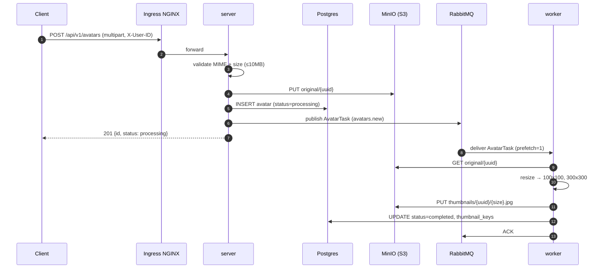
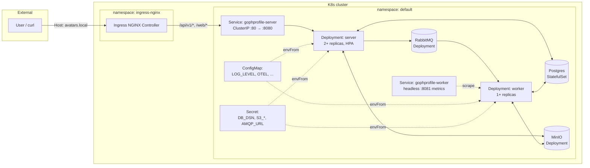

# GophProfile


Микросервис управления аватарками пользователей — учебный проект курса «Go-разработчик» от Yandex Practicum.

## Стек

- Go 1.26, chi
- PostgreSQL (метаданные)
- MinIO (S3-совместимое хранилище)
- RabbitMQ (очередь на асинхронную обработку)
- Docker Compose

## Быстрый старт (в WSL)

```bash
cd /mnt/c/Users/daulet.sakanayev/Desktop/dev/gophprofile
docker compose up -d
make build
./bin/server
./bin/worker
```

## Архитектура

### Компоненты

- **server** — HTTP API (chi), принимает upload, валидирует MIME/размер, кладёт оригинал в S3, записывает метаданные в Postgres, публикует задачу в RabbitMQ.
- **worker** — консьюмер RabbitMQ, генерирует thumbnails (100x100, 300x300) через `nfnt/resize`, кладёт в S3, обновляет status в Postgres.
- **Postgres** — метаданные аватаров (`avatars`) + таблица учёта миграций (`schema_migrations`).
- **S3/MinIO** — binary storage: оригиналы (`original/{uuid}`) + thumbnails (`thumbnails/{uuid}/{size}.jpg`).
- **RabbitMQ** — очереди `avatars.new` (upload → worker) и `avatars.delete` (soft delete → cleanup).

### Поток загрузки



### Инфраструктура в Kubernetes



### Observability

- **Логи** — JSON через `slog` (`log/slog`); в docker-compose Fluent Bit → OpenSearch; в K8s — через `kubectl logs` / Loki (не входит в sprint).
- **Метрики** — Prometheus endpoint `/metrics` на `:8080` (server) и `:8081` (worker). Собственные метрики: counters uploads/thumbnails, histograms upload duration, gauges queue depth / storage bytes / DB connections.
- **Трейсы** — OpenTelemetry с OTLP exporter (gRPC) в Jaeger. HTTP server инструментирован через `otelchi`; AMQP context propagation через headers.


### API документация

- **OpenAPI 3.1 spec:** [api/openapi.yaml](api/openapi.yaml)
- **Swagger UI (live, в развёрнутом сервисе):** `http://avatars.local:8080/swagger`
- **Raw spec (из развёрнутого сервиса):** `http://avatars.local:8080/openapi.yaml`

## Deployment в Kubernetes (Helm)

Чарт лежит в [deploy/helm/gophprofile/](deploy/helm/gophprofile/), K8s-манифесты инфры — в [deploy/k8s/infra.yaml](deploy/k8s/infra.yaml).

### Что внутри чарта

| Ресурс | Описание |
|---|---|
| `Deployment` server + worker | SecurityContext: non-root, `readOnlyRootFilesystem`, `drop ALL caps`, `seccompProfile: RuntimeDefault` |
| `Service` | ClusterIP для server; headless для worker (под ServiceMonitor) |
| `Ingress` nginx | Хост `avatars.local`, `proxy-body-size: 10m` (10MB upload по ТЗ) |
| `HPA` autoscaling/v2 | CPU 70% + Memory 80%, scale-up/down behavior |
| `ConfigMap` + `Secret` | Через `envFrom`; checksum-аннотации → rolling restart при изменении |
| `NetworkPolicy` | default-deny + allow ingress-nginx + allow Prometheus scrape |
| `ServiceMonitor` | Для prometheus-operator (CRD) |
| `ServiceAccount` | `automountServiceAccountToken: false` |

Graceful shutdown через `preStop` sleep + `terminationGracePeriodSeconds: 30`. Rolling update с `maxUnavailable: 0` — zero-downtime.

### Prerequisites

- Docker Desktop с WSL2 integration
- [kind](https://kind.sigs.k8s.io/) 0.23+
- [kubectl](https://kubernetes.io/docs/tasks/tools/)
- [helm](https://helm.sh/) 3.x
- WSL2 с включённым systemd (`/etc/wsl.conf`: `[boot] systemd=true`)

### 1. Создать kind cluster

~~~bash
cat > ~/kind-config.yaml <<'EOF'
kind: Cluster
apiVersion: kind.x-k8s.io/v1alpha4
name: gophprofile
nodes:
  - role: control-plane
    kubeadmConfigPatches:
      - |
        kind: InitConfiguration
        nodeRegistration:
          kubeletExtraArgs:
            node-labels: "ingress-ready=true"
    extraPortMappings:
      - containerPort: 80
        hostPort: 8080
        protocol: TCP
      - containerPort: 443
        hostPort: 8443
        protocol: TCP
EOF

kind create cluster --config ~/kind-config.yaml
kubectl cluster-info --context kind-gophprofile
~~~

> Если кластер с таким именем уже существует — либо используй его, либо `kind delete cluster --name gophprofile` перед созданием.

### 2. Поставить Ingress NGINX controller

~~~bash
kubectl apply -f https://raw.githubusercontent.com/kubernetes/ingress-nginx/main/deploy/static/provider/kind/deploy.yaml
kubectl wait --namespace ingress-nginx \
  --for=condition=ready pod \
  --selector=app.kubernetes.io/component=controller \
  --timeout=180s
~~~

> При повторном `kubectl apply` могут появиться ошибки `Invalid value: ...: field is immutable` на Jobs `ingress-nginx-admission-create/patch` — это норма (Jobs уже отработали, перезаписать их нельзя). Controller при этом обновится.

### 3. Загрузить образы приложения в kind

~~~bash
docker build -f Dockerfile.server -t gophprofile-server:latest .
docker build -f Dockerfile.worker -t gophprofile-worker:latest .
kind load docker-image gophprofile-server:latest --name gophprofile
kind load docker-image gophprofile-worker:latest --name gophprofile
~~~

### 4. Поставить инфраструктуру (Postgres + MinIO + RabbitMQ)

Postgres — через Bitnami helm chart:

~~~bash
helm repo add bitnami https://charts.bitnami.com/bitnami
helm repo update

helm install gophprofile-postgresql bitnami/postgresql \
  --set auth.username=gophprofile \
  --set auth.password=gophprofile \
  --set auth.database=gophprofile \
  --set primary.persistence.size=1Gi
~~~

MinIO + RabbitMQ — локальные K8s манифесты (образы заранее на хосте, грузим в kind):

~~~bash
kind load docker-image minio/minio:latest --name gophprofile
kind load docker-image rabbitmq:3-management-alpine --name gophprofile
kubectl apply -f deploy/k8s/infra.yaml
~~~

> Приложение само создаёт bucket `avatars` при старте — отдельный `mc`-Job не нужен.

### 5. Задеплоить приложение

~~~bash
helm install gophprofile deploy/helm/gophprofile \
  -f deploy/helm/gophprofile/values-dev.yaml

kubectl get pods -w
~~~

Жди пока все pod'ы (`gophprofile-postgresql-0`, `gophprofile-minio-...`, `gophprofile-rabbitmq-...`, `gophprofile-server-...`, `gophprofile-worker-...`) не станут `1/1 Running`.

### 6. Smoke-test через Ingress

~~~bash
# Healthcheck
curl -H "Host: avatars.local" http://localhost:8080/healthz
# {"components":{"broker":"ok","database":"ok","s3":"ok"},"status":"ok"}

# Upload аватара
curl -X POST \
  -H "Host: avatars.local" \
  -H "X-User-ID: user-123" \
  -F "file=@/path/to/image.jpg;type=image/jpeg" \
  http://localhost:8080/api/v1/avatars

# Метадата (thumbnails готовы через 1-2 секунды)
AVATAR_ID=<id-из-прошлого-ответа>
curl -H "Host: avatars.local" \
  http://localhost:8080/api/v1/avatars/$AVATAR_ID/metadata
~~~

### Обновление приложения

~~~bash
# После пересборки образа
kind load docker-image gophprofile-server:latest --name gophprofile
kubectl rollout restart deployment/gophprofile-server
~~~

Либо через `helm upgrade` — checksum-аннотации на `ConfigMap`/`Secret` триггерят rolling restart при изменении values.

### Troubleshooting

- **HPA требует metrics-server.** Для kind:
  ~~~bash
  kubectl apply -f https://github.com/kubernetes-sigs/metrics-server/releases/latest/download/components.yaml
  kubectl patch -n kube-system deployment metrics-server --type=json \
    -p='[{"op":"add","path":"/spec/template/spec/containers/0/args/-","value":"--kubelet-insecure-tls"}]'
  ~~~

- **`avatars.local` не резолвится** — добавь в `C:\Windows\System32\drivers\etc\hosts` (от админа):
  ~~~
  127.0.0.1 avatars.local
  ~~~

- **NetworkPolicy в kind не работает** — kindnet CNI не enforce'ит. В dev `networkPolicy.enabled=false`.

- **ServiceMonitor требует prometheus-operator** — для prod. В dev `serviceMonitor.enabled=false`.
